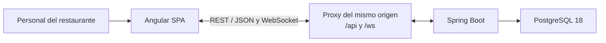
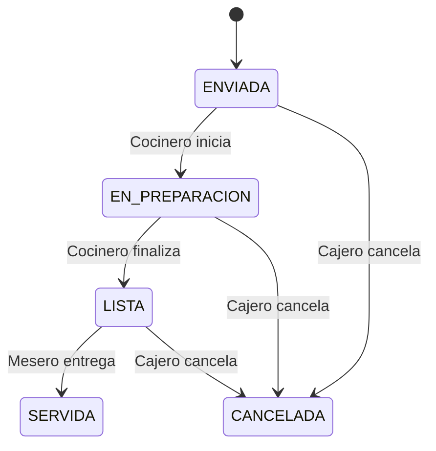

# SIVANT · Arquitectura de implementación

**Stack** · Angular con TypeScript, Spring Boot y PostgreSQL 18  
**Alcance** · Diseño implementable de RF01–RF26. Fuente funcional: RF entregados para este diseño. Fuente de persistencia: [modelo-datos-logico-relacional.md](./modelo-datos-logico-relacional.md).

Este documento fija la estructura de módulos, los contratos HTTP y las invariantes que deben guiar la implementación. Los nombres de las entidades y los enumerados siguen el modelo adjunto. Las decisiones necesarias para cerrar vacíos de los RF se indican en la sección 9.

## 1. Arquitectura general

Implementar un monolito modular. Spring Boot despliega una aplicación que expone una API REST versionada. Angular es una SPA. Un proxy sirve Angular y dirige `/api/**` a Spring Boot bajo el mismo origen. PostgreSQL 18 es la base transaccional. El navegador usa la API para consultar y ejecutar operaciones. Mantener un entorno local reproducible con Docker Compose y un perfil de desarrollo con datos de prueba.



Las consultas y los comandos usan la API REST. WebSocket distribuye eventos confirmados de cocina, servicio, notificaciones e inventario. Los comandos que cambian información continúan ejecutándose exclusivamente mediante HTTP para conservar validación, idempotencia y respuestas de error uniformes.

La TPV opera de forma externa. El mesero captura la referencia de un cargo ya aprobado. El administrador registra la evidencia de la devolución o reversión realizada por el método correspondiente. SIVANT conserva el resultado y su auditoría. El navegador y la API manejan referencias y montos de pago. Excluir PAN, CVV y demás datos de tarjeta de formularios, registros y almacenamiento.

| Módulo | Responsabilidad | Relación con otros módulos |
|---|---|---|
| Identidad | Inicio y cierre de sesión, principal y permisos | Consulta empleados activos |
| Empleados | Alta, consulta, edición, desactivación | Identidad consulta su estado y rol |
| Catálogo | Artículos, productos, insumos, subtipos, recetas e imagen opcional del artículo | Inventario inicializa existencias para reventa. Comandas consulta precios. Inventario consulta receta al servir |
| Servicio | Mesas, cuentas, comandas, detalles, estados y cancelación de comanda | Cocina y ventas usan sus interfaces de aplicación. Al servir invoca inventario y notificaciones |
| Cocina | Vista ordenada y acciones de preparación | Ejecuta transiciones en servicio y consulta notificaciones |
| Ventas y caja | Cobro, pagos, cancelación de ventas, rendición de efectivo y cambio | Cobro bloquea y cierra la cuenta mediante servicio. Caja usa pagos en efectivo |
| Inventario | Existencias, movimientos, solicitudes y consumo al servir | Consulta catálogo y publica alertas persistentes |
| Notificaciones | Bandeja por usuario y rol, lectura y eventos de operación | Persiste eventos emitidos por servicio, cocina e inventario |

Las dependencias cruzan módulos mediante interfaces de aplicación y DTO internos. Cada módulo controla sus escrituras. Los casos de uso de servicio y ventas comparten transacción cuando cierran cuenta, sirven una comanda o necesitan persistir una notificación. Las lecturas de detalle e historial pueden usar consultas de proyección específicas.

## 2. Aplicación Angular

```
sivant/
  frontend/
    src/app/
      app.config.ts
      app.routes.ts
      core/
        auth/
        http/
        realtime/
        layout/
      shared/
        ui/
      features/
        mesas-cuentas/
        comandas/
        cocina/
        cobro/
        caja/
        ventas/
        productos/
        empleados/
        inventario/
        notificaciones/
  backend/
    src/main/java/mx/sivant/
    src/main/resources/db/migration/
    src/test/
  infra/
    compose.yaml
  docs/
    arquitectura-sivant.md
    openapi.yaml
```

Usar componentes standalone, carga diferida por funcionalidad, formularios reactivos tipados y `HttpClient`. Dentro de cada funcionalidad, organizar las pantallas en `pages/`, componentes específicos en `components/` y clientes y contratos en `data-access/`. Mantener el estado de formularios y vistas dentro de la funcionalidad. La sesión y la bandeja son servicios de aplicación compartidos. Usar la respuesta del backend para importes, permisos por registro, estados y marcas de tiempo.

| Ruta | Rol | Función |
|---|---|---|
| `/login` | Público | Iniciar sesión |
| `/mesas`, `/cuentas/:id` | Mesero. Cajero con vista operativa de cancelaciones | Abrir y consultar cuentas, registrar comandas y operar sobre ellas según rol |
| `/cuentas/:id/cobro` | Mesero responsable | Total, método, referencia externa y confirmación |
| `/cocina` | Cocinero | Cola, inicio, listo y avisos de modificación o cancelación |
| `/ventas`, `/ventas/:id` | Administrador, cajero | Historial, filtros, detalle. Cancelación solo para administrador |
| `/caja/entregas` | Cajero | Pagos en efectivo pendientes, recepción con lo recibido y cambio |
| `/productos` | Administrador. Mesero con catálogo operativo | Búsqueda y estado, con la imagen del producto o un marcador si no tiene. Alta, edición, desactivación e imagen para administrador |
| `/empleados` | Administrador | Listado, filtros y gestión |
| `/inventario`, `/inventario/ajustes` | Almacenista, administrador | Existencias e historial. Almacenista registra movimientos y solicita ajustes. Administrador resuelve solicitudes |
| `/notificaciones` | Sesión activa | Bandeja filtrada por destinatario autorizado |

La cuenta muestra las comandas canceladas con su justificación y excluye su subtotal del total. La pantalla de cocina ordena por fecha de envío e ID y muestra mesa, cuenta, productos, cantidades y observaciones. Angular mantiene una conexión WebSocket autenticada para recibir eventos de nuevas comandas, modificaciones, cancelaciones, cambios de estado y alertas. Al recibir un evento, la funcionalidad afectada actualiza sus datos mediante la API REST. Al reconectar, el cliente vuelve a consultar su estado para recuperar cualquier evento no recibido. Ante `409`, actualizar la vista y conservar los datos editados para revisión. Deshabilitar temporalmente el botón de confirmación mientras la solicitud está en curso y reutilizar la misma clave de idempotencia si ocurre un fallo de red.

Mantener filtros de listados en parámetros de ruta y usar rutas relativas para la API. Aplicar guards para navegación y mostrar acciones según el rol y los permisos que devuelve la API. Spring Security y los casos de uso vuelven a comprobar los permisos sobre cada operación y registro. [Documentación de Angular sobre guards](https://angular.dev/guide/routing/route-guards).

## 3. Backend Spring Boot

Usar Java 21, Maven Wrapper, Spring Web MVC, Spring WebSocket, Spring Security, Bean Validation, Spring Data JPA, Flyway y el driver JDBC PostgreSQL. Fijar en el proyecto versiones compatibles al generar el esqueleto. Publicar OpenAPI como contrato compartido con Angular. Administrar el esquema con Flyway y configurar Hibernate para validarlo.

```
mx.sivant
  identidad
  empleados
  catalogo
  servicio
  cocina
  ventas
  inventario
  notificaciones
  infraestructura
```

En cada módulo, `api` contiene controladores y DTO de transporte, `aplicacion` contiene casos de uso y límites transaccionales, `dominio` conserva las reglas de estado y cálculo, e `infraestructura` implementa repositorios y consultas. En `ventas` agrupar cobro y caja como casos de uso distintos. El módulo `cocina` expone su consulta y delega las transiciones a servicio. Los controladores identifican al actor desde el principal y delegan al caso de uso. Los DTO controlan el contrato público. Las entidades JPA son internas.

### Sesión y permisos

Sesión de Spring Security con cookie `HttpOnly`, `Secure` en HTTPS y `SameSite=Lax`. Usar protección CSRF compatible con SPA, token en `XSRF-TOKEN` y encabezado `X-XSRF-TOKEN`. Obtener token al iniciar y renovarlo tras login o logout. Validar el estado activo y el rol actual del empleado en cada solicitud autenticada, incluida la consulta de sesión. Spring Security obtiene la autoridad desde la relación `EMPLEADO.id_rol → ROL.id_rol` y usa `ROL.nombre` como nombre de autoridad. Invalidar las sesiones existentes del empleado al desactivarlo, cambiar su contraseña o modificar su rol. Guardar hashes mediante `PasswordEncoder` con BCrypt. Excluir contraseñas, hashes y tokens de DTO de lectura y logs. [Documentación de Spring Security sobre CSRF para SPA](https://docs.spring.io/spring-security/reference/7.0/servlet/exploits/csrf.html).

| Acción | Autorización en servidor |
|---|---|
| Abrir cuenta, registrar, modificar, servir y cobrar | `MESERO`, propietario de la cuenta. El creador es el responsable histórico de la cuenta |
| Consultar cuenta | Mesero responsable o cajero. El cocinero recibe los datos operativos por su cola |
| Cancelar comanda | `CAJERO` |
| Consultar cocina, iniciar preparación y marcar lista | `COCINERO` |
| Consultar venta y cancelar venta | Consultar `ADMINISTRADOR` o `CAJERO`. Cancelar `ADMINISTRADOR` |
| Gestionar empleados y productos | `ADMINISTRADOR`, incluida la imagen del producto. Mesero puede consultar productos activos |
| Consultar inventario y resolver ajuste | Consultar `ADMINISTRADOR` o `ALMACENISTA`. Resolver `ADMINISTRADOR` |
| Registrar movimiento manual y solicitar ajuste | `ALMACENISTA` |
| Registrar recepción de efectivo y cambio | `CAJERO` |
| Leer notificación | Empleado destinatario o empleado activo del rol destinatario |

## 4. Contratos HTTP

Prefijo `/api/v1`. El ID del actor viene de sesión. IDs como cadenas decimales en JSON, cantidades de comandas como enteros, dinero y cantidades de inventario como cadenas decimales. Tiempos en ISO 8601 con offset. El servidor fija el tiempo de las operaciones. Los filtros por día se convierten con `America/Mexico_City` a un rango semiabierto `[desde,hasta)`. Listados con `page` base cero, `size` predeterminado de 25 y máximo de 100, orden estable e ID para desempate. En `GET /cocina/cola` conservar el orden ascendente de envío.

Los DTO públicos continúan usando el nombre del rol, por ejemplo `MESERO` o `COCINERO`. El backend resuelve ese valor contra `ROL.nombre`; los clientes no envían ni dependen de los identificadores internos de la tabla.

| RF | Método y ruta | Entrada principal y resultado |
|---|---|---|
| Soporte | `GET /auth/csrf`, `POST /auth/login`, `POST /auth/logout`, `GET /auth/me` | Token, credenciales, cierre y perfil con ID, nombre y rol |
| RF01 | `GET /mesas`, `POST /cuentas` | Listado con disponibilidad. Apertura con `mesaId` y respuesta de cuenta |
| RF01/RF04/RF23/RF26 | `GET /cuentas`, `GET /cuentas/:id` | Listado filtrable por `estado,mesaId`. Detalle con cuenta, mesa, responsable, comandas y sus detalles, cancelaciones, total, estado, versión y acciones disponibles |
| RF01 | `POST /cuentas/:id/comandas` | `detalles[{productoId,cantidad,observaciones}]`. Crea comanda enviada |
| RF02 | `PUT /comandas/:id/detalles` | `version` y detalles existentes `[{detalleId,cantidad}]`. Omisión de un detalle equivale a eliminarlo. Devuelve comanda y total actualizado |
| RF03 | `POST /comandas/:id/cancelacion` | `version` y `justificacion`. Devuelve comanda cancelada |
| RF04, RF05 | `POST /cuentas/:id/cobro` | `versionCuenta, metodo, referenciaExterna, totalEsperado`. Devuelve venta, pago y cuenta cerrada |
| RF06 | `GET /ventas`, `GET /ventas/:id` | Filtros `desde,hasta,estado,metodo,meseroId,mesaId`. Detalle con pago y cancelación |
| RF07, RF08, RF09, RF10 | `POST /productos`, `GET /productos`, `GET /productos/:id`, `PATCH /productos/:id`, `POST /productos/:id/desactivacion` | Alta con `nombre,descripcion,precioVenta,tipo,unidadMedida` y receta o nivel mínimo según tipo. Filtros `q,activo,tipo`. Edición de nombre, descripción y precio. La consulta devuelve `imagen`: URL con la versión del archivo, o ausente |
| RF07, RF09 (imagen) | `PUT /productos/:id/imagen`, `DELETE /productos/:id/imagen`, `GET /productos/:id/imagen` | `PUT` en `multipart/form-data` con el campo `archivo`; sustituye la imagen y devuelve el producto. `DELETE` la quita. `GET` sirve el archivo con su tipo y caché privada; el mesero solo ve las de productos activos |
| Imagen de insumo | `PUT /insumos/:id/imagen`, `DELETE /insumos/:id/imagen`, `GET /insumos/:id/imagen` | El administrador sustituye o quita la imagen. Administrador y almacenista pueden verla desde inventario. Usa las mismas validaciones y caché que la imagen del producto |
| Alta de insumo | `POST /insumos` | El administrador registra `nombre,unidadMedida,nivelMinimo`; crea también su existencia en cero. El surtido se registra después como movimiento del almacenista |
| RF11, RF12, RF13, RF14 | `POST /empleados`, `GET /empleados`, `GET /empleados/:id`, `PATCH /empleados/:id`, `POST /empleados/:id/desactivacion` | Alta con `nombreCompleto,correo,contrasena,rol`. Filtros `nombre,correo,rol,estado`. Edición parcial. Desactivación con `confirmado` |
| RF15 | `POST /inventario/ajustes/:id/resolucion` | `decision` igual a `AUTORIZADA` o `RECHAZADA`. Devuelve solicitud resuelta |
| RF16 | `GET /inventario/existencias`, `GET /inventario/existencias/:id/movimientos` | Filtros `q,tipo,nivelBajo` para existencias y fechas para movimientos. Incluye unidad, cantidad y mínimo |
| RF17 | `POST /inventario/existencias/:id/movimientos` | `tipo` de entrada o salida manual y `cantidad`. Devuelve movimiento y existencia actualizada |
| RF18 | `POST /inventario/ajustes`, `GET /inventario/ajustes` | `existenciaId,cantidadSolicitada,justificacion`. Filtros `estado,existenciaId` |
| RF19 | `GET /cocina/cola` | Comandas `ENVIADA`, `EN_PREPARACION` y `LISTA` con mesa, cuenta, detalle y versión |
| RF20 | `POST /comandas/:id/preparacion` | `version`. Devuelve comanda actualizada |
| RF21 | `POST /comandas/:id/lista` | `version`. Devuelve comanda actualizada y genera notificación |
| RF22 | `POST /ventas/:id/cancelacion` | `confirmado,justificacion,referenciaReversion` según método. Devuelve venta cancelada, pago original y auditoría |
| RF23, RF24 | `POST /comandas/:id/servicio` | `version`. Devuelve comanda servida y resultado de consumo. El descuento es parte del caso de uso |
| RF25 | `GET /caja/pagos-efectivo-pendientes`, `POST /caja/entregas-efectivo` | Filtro `meseroId`. Recepción con `meseroId` y `pagos[]` de `pagoId,montoRecibido`. Devuelve entrega, fecha, cajero, monto, cambio y cada pago con lo recibido y su cambio |
| RF26 | `POST /caja/entregas-efectivo` | Cada pago lleva `montoRecibido`; el cambio es lo recibido menos el importe |
| Soporte | `GET /notificaciones`, `PUT /notificaciones/:id/lectura` | Filtrar por estado de lectura del usuario actual. Marcar lectura individual |

Usar `201` cuando se crea un recurso, `200` para consultas y operaciones que devuelven estado actualizado y `204` para logout y lectura registrada. Errores en formato Problem Details con `type,title,status,detail,instance,codigo` y `erroresCampo` cuando aplique. `400` para forma o campos inválidos, `401` para sesión ausente, `403` para rol sin permiso, `404` para recursos ausentes o fuera del ámbito del actor, `409` para versión obsoleta, transición inválida, duplicidad o existencias insuficientes en salida manual.

### Contrato WebSocket

Exponer un endpoint autenticado bajo `/ws`, servido por el mismo origen. La sesión HTTP autentica la conexión y Spring Security restringe las suscripciones según el usuario y su rol. El servidor publica únicamente después de confirmar la transacción que originó el evento.

| Destino | Suscriptor autorizado | Eventos |
|---|---|---|
| `/user/queue/notificaciones` | Empleado autenticado | Notificaciones individuales, incluida `COMANDA_LISTA` para el mesero responsable |
| `/topic/cocina` | `COCINERO` | Nueva comanda, modificación, cancelación y actualización de la cola |
| `/topic/inventario` | `ALMACENISTA` | `ALERTA_INVENTARIO` y cambios que requieren actualizar la consulta |

El mensaje incluye `eventoId`, `tipo`, `recursoId`, `version` y `fechaHora`. El evento avisa que existe un cambio; Angular obtiene el estado autoritativo mediante REST. Los clientes ignoran eventos repetidos por `eventoId` y, después de una reconexión, vuelven a consultar los recursos visibles.

## 5. Flujos y reglas transaccionales

### Cuenta, comanda y cocina



1. **Apertura y envío.** Insertar una cuenta `ABIERTA` para una mesa libre. El envío exige cuenta abierta y al menos un detalle, productos activos y cantidades positivas. Normalizar observaciones vacías a `''` y agrupar líneas con el mismo producto y observaciones. Guardar el precio vigente en cada detalle. El alta de comanda, detalles e historial inicial se confirma junta. Registrar `estado_anterior = NULL` en la primera transición.
2. **Edición.** Admitir cambios de cantidad y eliminación parcial en `ENVIADA` o `EN_PREPARACION` con cuenta abierta. Si se intenta borrar el último detalle, responder `409` y conservar la comanda. Mantener precios guardados y permitir ajustar cantidades de líneas existentes aunque el producto haya sido desactivado. Los consumos adicionales se registran en una comanda nueva. Modificar en preparación inserta `MODIFICACION_COMANDA` para `COCINERO` en la misma transacción.
3. **Cancelación de comanda.** Exigir estado elegible, cuenta abierta sin pago y justificación con contenido. Guardar `CANCELACION_COMANDA`, transición, estado y notificación a cocina. Mantener todos los detalles existentes al momento de cancelar.
4. **Preparación y listo.** Persistir en cada transición el actor y el instante. Al marcar lista, crear `COMANDA_LISTA` para el mesero de la cuenta, indicando mesa, cuenta y comanda. El estado `LISTA` continúa en la cola hasta servicio o cancelación. La cuenta permanece abierta mientras exista una comanda no cancelada pendiente de servicio.
5. **Servicio y consumo.** Permitir `LISTA → SERVIDA` para el mesero responsable, también si la cuenta ya fue cobrada. Por cada detalle, multiplicar unidades pedidas por la cantidad de receta para cada insumo. Para reventa, consumir unidades de la existencia del producto. Bloquear las existencias afectadas por ID ascendente, comparar demanda total por existencia con la cantidad previa y aplicar el consumo íntegro. Guardar un `CONSUMO_VENTA` por par detalle–existencia. Crear una alerta por existencia insuficiente en ese servicio. Una existencia puede quedar negativa. El historial de comanda, el consumo y las alertas se confirman juntos. Un fallo de persistencia revierte la operación completa.

### Cobro, venta y efectivo

1. **Cobrar.** Bloquear cuenta abierta, comprobar dueño, versión y total esperado. Exigir una comanda no cancelada como mínimo y que todas las comandas no canceladas estén `SERVIDA`. Calcular un total mayor que cero con los precios históricos. Para tarjeta exigir referencia de autorización. Transferencia admite una referencia opcional. Insertar venta `COMPLETADA` y su único pago por el total. En efectivo, el mesero lleva el dinero a caja. Cerrar la cuenta y registrar fecha de cierre en la misma transacción.
2. **Cancelar venta.** Bloquear venta completada, confirmar decisión y justificación. El administrador registra una devolución completa. La referencia de reversión es obligatoria para tarjeta y transferencia. Para efectivo, caja realiza la devolución física y el administrador registra en SIVANT la cancelación y el importe devuelto. Conservar pago y cuenta cerrada. El estado de la venta pasa a `CANCELADA`. Las comandas mantienen su ciclo y los movimientos de consumo ya aplicados permanecen.
3. **Entregar efectivo.** El cajero selecciona uno o más pagos en efectivo de monto positivo, del mismo mesero y pendientes de rendir. Bloquear pagos por ID ascendente. Por cada pago, lo recibido debe cubrir su importe; la diferencia es el cambio que entrega el cajero. Registrar la entrega, asociar los pagos juntos y guardar en `FONDO_CAMBIO` lo recibido y el cambio de cada pago con cambio. Una devolución previa se documenta por separado. El pago original sigue siendo rendible porque la devolución sale de caja. La asociación única impide rendir el mismo pago dos veces.
4. **Dar el cambio.** Al recibir un pago en efectivo, el cajero registra lo que entregó el cliente. Si es mayor que el importe, registrar el cambio ligado al pago y a la entrega. El total de cambio se guarda en la entrega.

### Inventario y notificaciones

- **Movimiento manual.** Bloquear la existencia y aplicar una cantidad positiva. Para salida, rechazar si el saldo disponible es menor que la cantidad solicitada. Persistir saldo y movimiento juntos. Permitir entradas para recuperar existencias negativas.
- **Solicitar ajuste.** Bloquear o leer de forma consistente la existencia, guardar cantidad y versión observadas, objetivo físico no negativo y justificación. Estado inicial `PENDIENTE`. La cantidad solicitada representa un saldo objetivo. Incluir solicitudes autorizadas y rechazadas en la consulta del historial de inventario.
- **Resolver ajuste.** Bloquear solicitud y existencia, validar que la solicitud siga pendiente. Si se autoriza, exigir que conserve la versión registrada al solicitar. Si cambió, responder `409` y permitir rechazar la anterior y crear otra con base actualizada. Si procede, fijar el saldo objetivo y registrar `AJUSTE` por la diferencia absoluta con dirección auditable, incluyendo saldo anterior y posterior. Rechazar solicitudes de ajuste sin diferencia. El rechazo conserva existencias y registra responsable y fecha.
- **Notificaciones.** Insertar la notificación con la operación de negocio. El endpoint de bandeja devuelve las destinadas al ID o al rol vigente del usuario. La lectura es por empleado, incluso en avisos de rol. Para alertas usar `id_existencia` como origen y guardar un contexto estructurado con comanda y faltante. Para mensajes de cocina usar `id_comanda` como origen. Guardar mensaje y contexto junto con el tipo. Después del commit, publicar el evento por WebSocket al destino autorizado. Si la publicación falla, la notificación persistida permanece disponible y el cliente la recupera al consultar su bandeja.

### Concurrencia y reintentos

Ejecutar los casos de uso de escritura con `@Transactional`. Para operaciones de cuenta, tomar primero `SELECT … FOR UPDATE` sobre la cuenta y luego sobre comanda y existencias cuando corresponda. Cobro y cancelación de comanda inspeccionan estado y pago bajo ese mismo bloqueo. En ajustes, bloquear solicitud y luego existencia. En entregas, bloquear pagos en orden de ID. Las operaciones de cierre o reembolso que registran actos físicos fuera de SIVANT se confirman en el sistema solo después de realizar el acto. Si falla el registro, reintentar con la misma referencia y clave, conservando la evidencia de la TPV o caja.

Mantener `version` en cuenta, comanda y existencia. Incrementar la versión de cuenta al agregar, editar o cancelar comandas que afecten el cálculo. Incrementar la versión de comanda en cada edición o transición y la de existencia en cada cambio de saldo. Las validaciones se hacen sobre las filas bloqueadas.

Exigir `Idempotency-Key` en los comandos de apertura, envío, cobro, cancelaciones, servicio, movimientos, solicitud y resolución de ajuste, y entrega de efectivo. Persistir en la misma transacción una fila única por actor, operación, recurso y clave, con huella del cuerpo y respuesta exitosa. Si coincide la huella, devolver el resultado guardado. Si cambia, responder `409`. El ámbito de la clave de apertura usa `mesaId`. Para las transiciones restantes, la versión y las restricciones de estado impiden aplicar el cambio dos veces.

## 6. PostgreSQL 18 · Relaciones físicas

Crear el esquema `sivant`. Usar nombres `snake_case`, IDs `bigint GENERATED BY DEFAULT AS IDENTITY`, `timestamptz` para instantes, `numeric(14,2)` para dinero y `numeric(18,6)` para unidades de inventario. En Java usar `BigDecimal`, en PostgreSQL `numeric` y validar la escala en entrada. Conservar UTC como referencia de persistencia e interpretar fechas de operación en la zona del negocio.

| Relación | Cardinalidad | Integridad física o transaccional |
|---|---|---|
| Rol → empleado | 1 a N | FK `EMPLEADO.id_rol`. `ROL.nombre` único. Los cinco roles se cargan mediante Flyway |
| Rol → notificación | 1 a N opcionales | FK nullable `NOTIFICACION.id_rol_destinatario`. XOR con destinatario individual |
| Mesa → cuenta | 1 a N históricas | FK e índice único parcial de cuenta abierta por mesa |
| Empleado → cuenta | 1 a N | FK de responsable. Rol y acceso en backend |
| Cuenta → comanda → detalle | 1 a N en ambos niveles | Una cuenta puede estar vacía. Una comanda tiene al menos un detalle. Identidad de línea única por comanda, producto y observaciones normalizadas |
| Producto → detalle | 1 a N | FK. Precio aplicado persistido en detalle |
| Comanda → historial / cancelación | 1 a N / 1 a 0..1 | Un evento por transición. Cancelación única por comanda |
| Cuenta → venta → pago | 1 a 0..1 / 1 a 1 | `UNIQUE` en ambas FKs. Transacción garantiza pago y coincidencia con total |
| Venta → cancelación | 1 a 0..1 | FK única. La cancelación referencia al administrador y conserva importe y referencia |
| Pago ↔ entrega de efectivo | 0..1 entrega por pago. 1..N pagos por entrega | Tabla puente con PK compuesta y `UNIQUE(id_pago)` |
| Pago → cambio ← entrega | 0..1 cambio por pago, dentro de la entrega que lo recibió | FK obligatorias a pago y entrega; validar método efectivo y que lo recibido sea el pago más el cambio |
| Artículo → producto o insumo | 1 a exactamente un subtipo | PK compartida, FK, creación conjunta y validación de exclusividad |
| Producto → preparado o reventa | 1 a exactamente un subtipo | PK compartida, FK y creación conjunta |
| Preparado ↔ insumo | N a M por receta | Un preparado tiene al menos un componente. Par preparado–insumo único |
| Existencia → existencia de insumo o de reventa | 1 a exactamente un subtipo | PK compartida. FK única a insumo o reventa. Insumo y reventa tienen exactamente una existencia |
| Existencia → movimiento / solicitud | 1 a N en ambas | FK. Consumo identificado por detalle–existencia. Ajuste como máximo uno por solicitud |
| Notificación → origen y destinatario | Un origen y un destinatario lógico | `CHECK` XOR sobre origen comanda/existencia y sobre empleado/rol. Lectura individual mediante tabla puente |

**Restricciones de filas.** Aplicar `NOT NULL`, `CHECK`, FKs y `UNIQUE` según el modelo. Usar `varchar` con `CHECK` para los enumerados de estado, método y tipo, y mantenerlos alineados con Java y TypeScript. Los roles se almacenan en `ROL` y no como enumerado. `ROL.nombre` es obligatorio y único. Correo obligatorio normalizado con `trim` y minúsculas, con índice único sobre `lower(correo)` y restricción para impedir blancos. Restringir borrados de registros con referencias históricas. Usar `fecha_hora_cierre IS NULL` para cuenta abierta y exigir fecha de cierre para cuenta cerrada. Exigir cantidad de detalle mayor a cero, precios y mínimos no negativos y cantidad de movimiento positiva. Permitir `cantidad_actual` negativa por consumo automático. Validar campos de resolución de solicitudes según estado y campos de origen de movimientos según tipo. Exigir referencia de autorización no vacía para tarjeta.

**Reglas entre tablas.** Usar transacciones de aplicación para validar estados, autorizaciones, sumas y correspondencia de pagos, movimientos y rendiciones. Reforzar con triggers de restricción diferibles las invariantes de estructura que se comprueban al commit: exclusividad y completitud de subtipos, preparado con receta, una existencia para cada insumo o reventa y obligatoriedad de pago por venta. Ejecutar esas validaciones desde cambios en padre e hijo. Los triggers validan integridad y los casos de uso ejecutan las transiciones de negocio.

```sql
CREATE UNIQUE INDEX uq_cuenta_mesa_abierta
    ON sivant.cuenta (id_mesa)
    WHERE estado = 'ABIERTA';

CREATE UNIQUE INDEX uq_consumo_detalle_existencia
    ON sivant.movimiento_inventario (id_detalle_comanda, id_existencia)
    WHERE tipo = 'CONSUMO_VENTA';
```

**Índices de consulta.** Empleado `(id_rol)` y rol con `UNIQUE(nombre)`. Comanda `(estado, fecha_hora_envio, id_comanda)` y `(id_cuenta)`. Detalle e historial por `id_comanda`. Venta `(fecha_hora DESC, id_venta DESC)` y compuesto por estado si el plan lo justifica. Pago `(metodo, fecha_hora)` y `(id_mesero, metodo)`. Notificación `(id_empleado_destino, fecha_hora)` y `(id_rol_destinatario, fecha_hora)`. Movimiento `(id_existencia, fecha_hora DESC)`. Solicitud `(estado, fecha_hora_solicitud)`. Índices de FKs para consultas y mantenimiento según acceso. [Documentación de PostgreSQL 18 sobre índices parciales](https://www.postgresql.org/docs/18/indexes-partial.html).

**Datos calculados.** Estado de mesa por cuenta abierta. Subtotales por cantidad y precio unitario guardado. Total de cuenta por suma de comandas no canceladas. Nivel bajo si `cantidad_actual <= nivel_minimo`. Guardar `VENTA.total` y `PAGO.monto` como importes históricos. La ventana de 24 meses limita la consulta operativa de RF06 y se calcula a partir de la fecha actual del negocio. Conservar las ventas históricas en base de datos.

**Migraciones.** Prioridad: roles, identidad y mesas → catálogo y existencias → cuentas y comandas → ventas y caja → inventario y notificaciones → restricciones diferibles e índices. Crear `ROL` antes de `EMPLEADO` y cargar de forma idempotente `MESERO`, `CAJERO`, `COCINERO`, `ADMINISTRADOR` y `ALMACENISTA`. Añadir `version` e `idempotencia_operacion`. En `MOVIMIENTO_INVENTARIO` agregar `saldo_anterior` y `saldo_posterior`, con escala de inventario y validación de diferencia. En `SOLICITUD_AJUSTE`, agregar `version_existencia_solicitada`. En `FONDO_CAMBIO` guardar `monto_recibido` y el cambio de un pago en efectivo, con `id_entrega` obligatorio. Crear `notificacion_lectura(id_notificacion,id_empleado,fecha_hora)` para la lectura individual y usar `contexto JSONB` para los datos estructurados del aviso. Referenciar todas las tablas por FK donde el modelo las identifica.

## 7. Entregables para el agente de implementación

1. Generar el monorepo con las carpetas propuestas, Maven Wrapper, Angular CLI y Compose para PostgreSQL 18. Incluir arranque documentado, configuración por entorno y secretos aportados por variables.
2. Crear migraciones reproducibles y preparar datos de desarrollo con la tabla `ROL`, sus cinco registros, mesas, productos de reventa, insumos y preparados con recetas. Para producción, provisionar los cinco roles antes de crear el administrador inicial, las mesas y los insumos mediante un proceso de carga autorizado. Las interfaces para administrar mesas, insumos y recetas se definirán posteriormente con los diseños proporcionados por el responsable del proyecto.
3. Implementar OpenAPI, sesión, empleados y catálogo. Implementar cuentas, comandas, cocina y notificaciones sobre las tablas definitivas.
4. Implementar inventario, servicio y consumo con una transacción de escritura. Implementar cobro, historial, cancelación, caja y cambio. Conectar Angular desde las rutas normales del usuario.
5. Ejecutar pruebas de integración sobre PostgreSQL 18 con Testcontainers para las invariantes críticas y pruebas de navegación por rol para la operación completa. Documentar cómo arrancar y cómo verificar cada bloque.

## 8. Aceptación por flujo

| RF | Resultado verificable |
|---|---|
| RF01–03 | Dos aperturas concurrentes dejan una cuenta abierta. Una comanda conserva precio y responsable. En preparación, la edición genera aviso. La cancelación exige motivo y preserva detalles. Si gana el cobro concurrente, la cancelación se rechaza |
| RF04–06 | Un doble envío de cobro crea un solo pago. Cobrar con comandas no canceladas pendientes de servicio produce `409`. Cambiar el total entre consulta y cobro produce `409`. Tarjeta exige referencia. Historial incluye completadas y canceladas y filtra dentro de 24 meses |
| RF07, RF08, RF09, RF10 | Alta de preparado crea receta y alta de reventa crea existencia. Editar precio no cambia históricos. Desactivar impide nuevas líneas y conserva referencias |
| RF11, RF12, RF13, RF14 | Correo duplicado con otro uso de mayúsculas se rechaza. Un usuario desactivado pierde acceso, incluso con una sesión previa. Los DTO de consulta excluyen secretos |
| RF15–18 | Una salida manual excedida falla. Dos resoluciones concurrentes generan a lo sumo un movimiento. Aprobar con existencias cambiadas devuelve `409`. Rechazar conserva el saldo |
| RF19–21 | Cola ordenada con estados vigentes. Saltar de enviada a lista falla. Marcar lista registra actor y fecha y avisa solo al mesero responsable |
| RF22 | Solo el administrador cancela una venta completada. El pago se conserva, se registra la devolución y el historial de consumos no cambia |
| RF23, RF24 | Servir dos veces aplica un solo consumo. Se registra existencia negativa y alerta si falta inventario. Un fallo de persistencia deja la comanda en su estado anterior |
| RF25–26 | Rendición rechaza tarjeta, transferencia, duplicados o lo recibido menor que el pago. El cambio queda ligado al pago y a la entrega, auditado |

## 9. Decisiones funcionales y operativas adoptadas

| Tema | Decisión para implementación |
|---|---|
| Responsable operativo | El mesero que abrió la cuenta gestiona sus comandas y cobra. Reasignar cuentas requeriría un flujo propio |
| Momento de cobro | Solo se permite cobrar cuando todas las comandas no canceladas estén `SERVIDA`. Al completar el pago se cierra la cuenta y se libera la mesa |
| Venta cancelada | La cancelación se realiza sobre una venta completada después del servicio. Registra la devolución y conserva los movimientos de inventario ya aplicados |
| Fondo de cambio | El mesero lleva el efectivo a caja al cobrar; el cajero registra lo recibido y entrega el cambio. No se presta dinero antes del cobro |
| Devolución en efectivo | Se efectúa desde caja. El importe original cobrado por el mesero sigue en su rendición. La devolución y la entrega conservan sus propios importes y registros |
| Edición de comanda | Se editan cantidades o se eliminan líneas existentes. Para retirar todas las líneas se usa cancelación por cajero. Para agregar consumo se crea otra comanda |
| Ajuste | La cantidad solicitada es la existencia final deseada. Si cambió la existencia desde la solicitud, se requiere una solicitud con la base actualizada para autorizar |
| Cocina y alertas | WebSocket distribuye eventos confirmados. REST conserva el estado autoritativo y permite recuperar cambios después de una reconexión. La lectura de avisos es independiente por usuario |
| Imagen de artículo | El administrador la sube para productos o insumos. El backend guarda el archivo en un almacén de archivos, por ahora una carpeta local del servidor (`SIVANT_IMAGENES_DIR`, por omisión `backend/almacen/`, no versionada), y la base guarda solo su ruta en `ARTICULO.imagen`. Para el despliegue se apunta a un volumen persistente o se cambia el almacén por uno externo sin tocar los datos. Solo JPG, PNG o WebP de hasta 2 MB; el tipo se valida por los primeros bytes y no se aceptan SVG. El archivo nuevo se escribe antes de guardar la ruta y se borra si la transacción falla; el anterior se borra después de confirmar. Si el artículo no tiene imagen o no carga, Angular muestra un marcador |
| Valores operativos | Moneda MXN y zona America/Mexico_City como configuración inicial. Se usa una sola operación de restaurante, con catálogo y existencias compartidos |
