# Modelo de datos lógico-relacional

Este documento presenta el modelo de datos lógico-relacional definitivo, alineado con los 26 requerimientos funcionales, el modelo de dominio y las reglas de negocio definidas. El diseño es independiente del gestor de base de datos y puede transformarse posteriormente a PostgreSQL, MySQL o SQL Server.

## Diagrama entidad-relación

```mermaid
erDiagram
    ROL {
        int id_rol PK
        string nombre UK
        string descripcion
    }

    EMPLEADO {
        int id_empleado PK
        int id_rol FK
        string nombre_completo
        string correo UK
        string contrasena_hash
        string estado
    }

    MESA {
        int id_mesa PK
        int numero UK
    }

    CUENTA {
        int id_cuenta PK
        int id_mesa FK
        int id_mesero FK
        datetime fecha_hora_apertura
        datetime fecha_hora_cierre
        string estado
    }

    COMANDA {
        int id_comanda PK
        int id_cuenta FK
        datetime fecha_hora_envio
        string estado
    }

    DETALLE_COMANDA {
        int id_detalle PK
        int id_comanda FK
        int id_producto FK
        int cantidad
        decimal precio_unitario
        string observaciones
    }

    HISTORIAL_ESTADO_COMANDA {
        int id_historial PK
        int id_comanda FK
        int id_empleado FK
        string estado_anterior
        string estado_nuevo
        datetime fecha_hora
    }

    CANCELACION_COMANDA {
        int id_cancelacion PK
        int id_comanda FK,UK
        int id_cajero FK
        datetime fecha_hora
        string justificacion
    }

    NOTIFICACION {
        int id_notificacion PK
        int id_comanda FK
        int id_existencia FK
        int id_empleado_destino FK
        int id_rol_destinatario FK
        string tipo
        string mensaje
        datetime fecha_hora
        json contexto
    }

    NOTIFICACION_LECTURA {
        int id_notificacion PK,FK
        int id_empleado PK,FK
        datetime fecha_hora
    }

    VENTA {
        int id_venta PK
        int id_cuenta FK,UK
        datetime fecha_hora
        decimal total
        string estado
    }

    PAGO {
        int id_pago PK
        int id_venta FK,UK
        int id_mesero FK
        datetime fecha_hora
        decimal monto
        string metodo
        string referencia_externa
    }

    CANCELACION_VENTA {
        int id_cancelacion_venta PK
        int id_venta FK,UK
        int id_administrador FK
        datetime fecha_hora
        string justificacion
        decimal monto_devuelto
        string referencia_reversion
    }

    ENTREGA_EFECTIVO {
        int id_entrega PK
        int id_mesero FK
        int id_cajero FK
        decimal monto
        datetime fecha_hora
    }

    ENTREGA_EFECTIVO_PAGO {
        int id_entrega PK,FK
        int id_pago PK,FK,UK
    }

    FONDO_CAMBIO {
        int id_fondo_cambio PK
        int id_cuenta FK
        int id_pago FK,UK
        int id_cajero FK
        int id_mesero FK
        decimal monto
        datetime fecha_hora
        string estado
        int id_cajero_anulacion FK
        datetime fecha_hora_anulacion
        string justificacion_anulacion
    }

    ARTICULO {
        int id_articulo PK
        string nombre
        string unidad_medida
        boolean activo
    }

    PRODUCTO {
        int id_producto PK,FK
        string descripcion
        decimal precio_venta
    }

    PRODUCTO_PREPARADO {
        int id_producto PK,FK
    }

    PRODUCTO_REVENTA {
        int id_producto PK,FK
    }

    INSUMO {
        int id_insumo PK,FK
    }

    RECETA_PRODUCTO {
        int id_receta_detalle PK
        int id_producto_preparado FK
        int id_insumo FK
        decimal cantidad_requerida
    }

    EXISTENCIA_INVENTARIO {
        int id_existencia PK
        decimal cantidad_actual
        decimal nivel_minimo
        datetime fecha_actualizacion
    }

    EXISTENCIA_INSUMO {
        int id_existencia PK,FK
        int id_insumo FK,UK
    }

    EXISTENCIA_PRODUCTO {
        int id_existencia PK,FK
        int id_producto_reventa FK,UK
    }

    MOVIMIENTO_INVENTARIO {
        int id_movimiento PK
        int id_existencia FK
        int id_empleado FK
        int id_detalle_comanda FK
        int id_solicitud_ajuste FK,UK
        string tipo
        decimal cantidad
        datetime fecha_hora
        string motivo
    }

    SOLICITUD_AJUSTE {
        int id_solicitud PK
        int id_existencia FK
        int id_almacenista FK
        int id_administrador FK
        decimal cantidad_anterior
        decimal cantidad_solicitada
        string justificacion
        string estado
        datetime fecha_hora_solicitud
        datetime fecha_hora_resolucion
    }

    ROL ||--o{ EMPLEADO : ""

    MESA ||--o{ CUENTA : ""
    EMPLEADO ||--o{ CUENTA : ""
    CUENTA ||--o{ COMANDA : ""
    COMANDA ||--|{ DETALLE_COMANDA : ""
    PRODUCTO ||--o{ DETALLE_COMANDA : ""

    COMANDA ||--|{ HISTORIAL_ESTADO_COMANDA : ""
    EMPLEADO ||--o{ HISTORIAL_ESTADO_COMANDA : ""
    COMANDA ||--o| CANCELACION_COMANDA : ""
    EMPLEADO ||--o{ CANCELACION_COMANDA : ""

    COMANDA o|--o{ NOTIFICACION : ""
    EXISTENCIA_INVENTARIO o|--o{ NOTIFICACION : ""
    EMPLEADO o|--o{ NOTIFICACION : ""
    ROL o|--o{ NOTIFICACION : ""
    NOTIFICACION ||--o{ NOTIFICACION_LECTURA : ""
    EMPLEADO ||--o{ NOTIFICACION_LECTURA : ""

    CUENTA ||--o| VENTA : ""
    VENTA ||--|| PAGO : ""
    EMPLEADO ||--o{ PAGO : ""
    VENTA ||--o| CANCELACION_VENTA : ""
    EMPLEADO ||--o{ CANCELACION_VENTA : ""

    EMPLEADO ||--o{ ENTREGA_EFECTIVO : ""
    EMPLEADO ||--o{ ENTREGA_EFECTIVO : ""
    ENTREGA_EFECTIVO ||--|{ ENTREGA_EFECTIVO_PAGO : ""
    PAGO ||--o| ENTREGA_EFECTIVO_PAGO : ""

    CUENTA ||--o{ FONDO_CAMBIO : ""
    PAGO o|--o| FONDO_CAMBIO : ""
    EMPLEADO ||--o{ FONDO_CAMBIO : ""
    EMPLEADO ||--o{ FONDO_CAMBIO : ""
    EMPLEADO o|--o{ FONDO_CAMBIO : ""

    ARTICULO ||--o| PRODUCTO : ""
    ARTICULO ||--o| INSUMO : ""
    PRODUCTO ||--o| PRODUCTO_PREPARADO : ""
    PRODUCTO ||--o| PRODUCTO_REVENTA : ""

    PRODUCTO_PREPARADO ||--|{ RECETA_PRODUCTO : ""
    INSUMO ||--o{ RECETA_PRODUCTO : ""

    EXISTENCIA_INVENTARIO ||--o| EXISTENCIA_INSUMO : ""
    EXISTENCIA_INVENTARIO ||--o| EXISTENCIA_PRODUCTO : ""
    INSUMO ||--|| EXISTENCIA_INSUMO : ""
    PRODUCTO_REVENTA ||--|| EXISTENCIA_PRODUCTO : ""

    EXISTENCIA_INVENTARIO ||--o{ MOVIMIENTO_INVENTARIO : ""
    EXISTENCIA_INVENTARIO ||--o{ SOLICITUD_AJUSTE : ""
    EMPLEADO o|--o{ MOVIMIENTO_INVENTARIO : ""
    DETALLE_COMANDA o|--o{ MOVIMIENTO_INVENTARIO : ""

    EMPLEADO ||--o{ SOLICITUD_AJUSTE : ""
    EMPLEADO o|--o{ SOLICITUD_AJUSTE : ""
    SOLICITUD_AJUSTE o|--o| MOVIMIENTO_INVENTARIO : ""
```

## Decisiones de almacenamiento

Los siguientes datos se calculan y **no se guardan como columnas**:

- Estado de la mesa: se obtiene comprobando si tiene una cuenta abierta.
- Subtotal del detalle: `cantidad × precio_unitario`.
- Subtotal de la comanda: suma de sus detalles.
- Total de la cuenta: suma de comandas no canceladas.
- Nivel bajo: `cantidad_actual <= nivel_minimo`.

Sí se almacena `VENTA.total`, porque representa el importe histórico al momento del cobro. También se almacena `DETALLE_COMANDA.precio_unitario`, para conservar el precio aplicado aunque después cambie el catálogo.

## Restricciones de integridad

### Empleados y roles

- `EMPLEADO.correo` es obligatorio y único.
- La contraseña se guarda únicamente como hash.
- Todo empleado debe referenciar exactamente un registro de `ROL` mediante `id_rol`.
- `ROL.nombre` es obligatorio y único.
- Los registros iniciales de `ROL` son `MESERO`, `CAJERO`, `COCINERO`, `ADMINISTRADOR` y `ALMACENISTA`.
- Los roles son un catálogo fijo; los RF no contemplan su alta, edición o eliminación desde la aplicación.
- Un empleado inactivo no puede iniciar sesión ni registrar nuevas operaciones.
- Las operaciones deben validar el rol del empleado involucrado.

### Cuentas y comandas

- Una mesa puede tener varias cuentas históricas, pero solamente una cuenta abierta simultáneamente.
- Una cuenta puede abrirse sin comandas.
- Una venta requiere al menos una comanda no cancelada.
- `fecha_hora_cierre` es nula mientras la cuenta esté abierta.
- La cantidad de un detalle debe ser mayor que cero.
- El precio unitario debe ser mayor o igual que cero.
- No deben repetirse dos detalles idénticos dentro de una comanda; alternativamente, debe acumularse su cantidad.

### Modificación y cancelación

- Una comanda `LISTA`, `SERVIDA` o `CANCELADA` no puede modificarse.
- Una comanda solo puede cancelarse si está `ENVIADA`, `EN_PREPARACION` o `LISTA`.
- La comanda no debe estar servida ni pertenecer a una cuenta con pago registrado.
- La cancelación requiere una justificación.
- Cada comanda puede tener como máximo una cancelación.
- Cada venta puede tener como máximo una cancelación.
- Solamente el administrador puede cancelar una venta completada.

### Ventas y pagos

- Cada cuenta genera como máximo una venta.
- Cada venta tiene exactamente un pago.
- `PAGO.monto = VENTA.total`.
- `referencia_externa` es obligatoria para tarjeta y puede utilizarse para transferencia.
- Una cancelación conserva la venta y el pago originales.
- La cancelación no elimina movimientos de inventario originados por productos servidos.

### Efectivo y fondo de cambio

- Una entrega debe agrupar uno o más pagos.
- Solamente pueden agruparse pagos cuyo método sea `EFECTIVO`.
- Cada pago en efectivo pertenece como máximo a una entrega.
- `ENTREGA_EFECTIVO.monto` debe ser igual a la suma de los pagos agrupados.
- El fondo de cambio se registra primero sobre una cuenta abierta y queda en estado `PENDIENTE`.
- Al cobrar la cuenta, un fondo pendiente obliga a utilizar el método `EFECTIVO` y se asocia con el pago, pasando a `APLICADO`.
- Cada cuenta puede tener como máximo un fondo `PENDIENTE` o `APLICADO`.
- Cada pago puede tener como máximo un fondo de cambio.
- Un fondo pendiente devuelto físicamente puede pasar a `ANULADO`, conservando cajero, fecha y justificación.

### Productos y recetas

- Todo artículo debe ser un producto o un insumo, nunca ambos.
- Todo producto debe ser preparado o de reventa, nunca ambos.
- Un producto preparado debe tener al menos un componente en su receta.
- Un producto preparado no tiene existencia propia.
- Un producto de reventa no necesita receta y tiene exactamente una existencia.
- No puede repetirse el mismo insumo en la receta de un producto.
- `cantidad_requerida` debe ser mayor que cero.

### Inventario

- Toda existencia debe ser de insumo o producto de reventa, nunca ambas.
- Todo insumo tiene exactamente una existencia.
- Todo producto de reventa tiene exactamente una existencia.
- `nivel_minimo` debe ser mayor o igual que cero.
- La cantidad de un movimiento debe ser mayor que cero.
- Las salidas manuales no pueden exceder la existencia disponible.
- El consumo automático puede dejar temporalmente una existencia negativa.
- Cada consumo automático debe relacionarse con el detalle de comanda que lo originó.
- Un movimiento `AJUSTE` debe relacionarse con una solicitud autorizada.
- Una solicitud pendiente no tiene administrador ni fecha de resolución.
- Una solicitud autorizada genera como máximo un movimiento.

### Notificaciones

- Una notificación se dirige mediante `id_empleado_destino` o `id_rol_destinatario`, pero no mediante ambos campos.
- Una notificación se origina en una comanda o en una existencia, pero no en ambas.
- `COMANDA_LISTA` se dirige al mesero responsable.
- Las modificaciones y cancelaciones enviadas a cocina se dirigen al rol `COCINERO`.
- `ALERTA_INVENTARIO` se dirige al rol `ALMACENISTA`.
- La lectura se registra individualmente en `NOTIFICACION_LECTURA`; una notificación dirigida a un rol no se considera leída para los demás empleados cuando uno de ellos la consulta.
- El campo `contexto` conserva datos estructurados necesarios para presentar el aviso, sin reemplazar las claves foráneas que identifican su origen.

## Catálogos enumerados

| Tipo | Valores |
|---|---|
| `EstadoEmpleado` | `ACTIVO`, `INACTIVO` |
| `EstadoCuenta` | `ABIERTA`, `CERRADA` |
| `EstadoComanda` | `ENVIADA`, `EN_PREPARACION`, `LISTA`, `SERVIDA`, `CANCELADA` |
| `EstadoVenta` | `COMPLETADA`, `CANCELADA` |
| `MetodoPago` | `EFECTIVO`, `TARJETA`, `TRANSFERENCIA` |
| `TipoNotificacion` | `MODIFICACION_COMANDA`, `CANCELACION_COMANDA`, `COMANDA_LISTA`, `ALERTA_INVENTARIO` |
| `TipoMovimiento` | `ENTRADA_MANUAL`, `SALIDA_MANUAL`, `CONSUMO_VENTA`, `AJUSTE` |
| `EstadoSolicitud` | `PENDIENTE`, `AUTORIZADA`, `RECHAZADA` |
| `UnidadMedida` | `PIEZA`, `GRAMO`, `KILOGRAMO`, `MILILITRO`, `LITRO` |
| `EstadoFondoCambio` | `PENDIENTE`, `APLICADO`, `ANULADO` |

Los roles no se implementan como un enumerado. Se almacenan en la tabla `ROL`, cargada inicialmente con los cinco valores definidos para el sistema.

## Índices recomendados

- Índice único sobre `EMPLEADO.correo`.
- Índice sobre `EMPLEADO.id_rol`.
- Índice único sobre `MESA.numero`.
- Índice para impedir más de una cuenta abierta por mesa.
- Índice sobre `COMANDA(estado, fecha_hora_envio)`.
- Índice sobre `VENTA(fecha_hora, estado)`.
- Índice sobre `PAGO(metodo, fecha_hora)`.
- Índice sobre `NOTIFICACION(id_empleado_destino, fecha_hora)`.
- Índice sobre `NOTIFICACION(id_rol_destinatario, fecha_hora)`.
- Clave primaria compuesta sobre `NOTIFICACION_LECTURA(id_notificacion, id_empleado)`.
- Índice sobre `MOVIMIENTO_INVENTARIO(id_existencia, fecha_hora)`.
- Índice sobre `SOLICITUD_AJUSTE(estado, fecha_hora_solicitud)`.
- Restricción única sobre `RECETA_PRODUCTO(id_producto_preparado, id_insumo)`.
- Restricción única sobre `ENTREGA_EFECTIVO_PAGO.id_pago`.
- Índice único parcial para impedir más de un fondo `PENDIENTE` o `APLICADO` por cuenta.

## Consideración para el modelo físico

Este es el modelo lógico definitivo. Para convertirlo en un modelo físico se debe elegir el gestor de base de datos, ya que algunas restricciones —como permitir solamente una cuenta abierta por mesa o validar los subtipos de artículos y existencias— se implementan de manera diferente en PostgreSQL, MySQL y SQL Server.
