# Modelo físico implementado

Generado desde el esquema `sivant` de PostgreSQL 18 después de aplicar las migraciones 1 a 9 (`backend/src/main/resources/db/migration`).
El modelo lógico ([modelo-datos-logico-relacional.md](modelo-datos-logico-relacional.md)) se conserva sin cambios; aquí
se ve lo que quedó en la base. «nulo» marca las columnas opcionales.

```mermaid
erDiagram
    ARTICULO {
        bigint id_articulo PK
        varchar nombre
        varchar unidad_medida
        boolean activo
    }
    AUDITORIA {
        bigint id_auditoria PK
        timestamptz fecha_hora
        bigint id_empleado FK "nulo"
        varchar accion
        varchar entidad
        bigint id_registro
        jsonb detalle
    }
    CANCELACION_COMANDA {
        bigint id_cancelacion PK
        bigint id_comanda FK,UK
        bigint id_cajero FK
        timestamptz fecha_hora
        varchar justificacion
    }
    CANCELACION_VENTA {
        bigint id_cancelacion_venta PK
        bigint id_venta FK,UK
        bigint id_administrador FK
        timestamptz fecha_hora
        varchar justificacion
        numeric monto_devuelto
        varchar referencia_reversion "nulo"
    }
    COMANDA {
        bigint id_comanda PK
        bigint id_cuenta FK
        timestamptz fecha_hora_envio
        varchar estado
        integer version
    }
    CUENTA {
        bigint id_cuenta PK
        bigint id_mesa FK
        bigint id_mesero FK
        timestamptz fecha_hora_apertura
        timestamptz fecha_hora_cierre "nulo"
        varchar estado
        integer version
    }
    DETALLE_COMANDA {
        bigint id_detalle PK
        bigint id_comanda FK,UK
        bigint id_producto FK,UK
        integer cantidad
        numeric precio_unitario
        varchar observaciones UK
    }
    EMPLEADO {
        bigint id_empleado PK
        bigint id_rol FK
        varchar nombre_completo
        varchar correo
        varchar contrasena_hash
        varchar estado
        integer sesion_version
    }
    ENTREGA_EFECTIVO {
        bigint id_entrega PK
        bigint id_mesero FK
        bigint id_cajero FK
        numeric monto
        numeric monto_fondo
        timestamptz fecha_hora
    }
    ENTREGA_EFECTIVO_PAGO {
        bigint id_entrega PK,FK
        bigint id_pago PK,FK,UK
    }
    EXISTENCIA_INSUMO {
        bigint id_existencia PK,FK
        bigint id_insumo FK,UK
    }
    EXISTENCIA_INVENTARIO {
        bigint id_existencia PK
        numeric cantidad_actual
        numeric nivel_minimo
        timestamptz fecha_actualizacion
        integer version
    }
    EXISTENCIA_PRODUCTO {
        bigint id_existencia PK,FK
        bigint id_producto_reventa FK,UK
    }
    FONDO_CAMBIO {
        bigint id_fondo_cambio PK
        bigint id_cuenta FK
        bigint id_pago FK,UK "nulo"
        bigint id_cajero FK
        bigint id_mesero FK
        numeric monto
        timestamptz fecha_hora
        varchar estado
        bigint id_cajero_anulacion FK "nulo"
        timestamptz fecha_hora_anulacion "nulo"
        varchar justificacion_anulacion "nulo"
        bigint id_entrega FK "nulo"
    }
    HISTORIAL_ESTADO_COMANDA {
        bigint id_historial PK
        bigint id_comanda FK
        bigint id_empleado FK
        varchar estado_anterior "nulo"
        varchar estado_nuevo
        timestamptz fecha_hora
    }
    IDEMPOTENCIA_OPERACION {
        bigint id_empleado PK,FK
        varchar operacion PK
        varchar recurso PK
        varchar clave PK
        character huella
        text respuesta "nulo"
        timestamptz fecha_hora
    }
    INSUMO {
        bigint id_insumo PK,FK
    }
    MESA {
        bigint id_mesa PK
        integer numero UK
    }
    MOVIMIENTO_INVENTARIO {
        bigint id_movimiento PK
        bigint id_existencia FK
        bigint id_empleado FK
        bigint id_solicitud_ajuste FK,UK "nulo"
        varchar tipo
        numeric cantidad
        numeric saldo_anterior
        numeric saldo_posterior
        timestamptz fecha_hora
        varchar motivo "nulo"
        varchar causa "nulo"
        bigint id_detalle_comanda FK "nulo"
    }
    NOTIFICACION {
        bigint id_notificacion PK
        bigint id_comanda FK "nulo"
        bigint id_existencia FK "nulo"
        bigint id_empleado_destino FK "nulo"
        bigint id_rol_destinatario FK "nulo"
        varchar tipo
        varchar mensaje
        timestamptz fecha_hora
        jsonb contexto
    }
    NOTIFICACION_LECTURA {
        bigint id_notificacion PK,FK
        bigint id_empleado PK,FK
        timestamptz fecha_hora
        boolean descartada
    }
    PAGO {
        bigint id_pago PK
        bigint id_venta FK,UK
        bigint id_mesero FK
        timestamptz fecha_hora
        numeric monto
        varchar metodo
        varchar referencia_externa "nulo"
    }
    PRODUCTO {
        bigint id_producto PK,FK
        varchar descripcion
        numeric precio_venta
    }
    PRODUCTO_PREPARADO {
        bigint id_producto PK,FK
    }
    PRODUCTO_REVENTA {
        bigint id_producto PK,FK
    }
    RECETA_PRODUCTO {
        bigint id_receta_detalle PK
        bigint id_producto_preparado FK,UK
        bigint id_insumo FK,UK
        numeric cantidad_requerida
    }
    ROL {
        bigint id_rol PK
        varchar nombre UK
        varchar descripcion
    }
    SOLICITUD_AJUSTE {
        bigint id_solicitud PK
        bigint id_existencia FK
        bigint id_almacenista FK
        bigint id_administrador FK "nulo"
        numeric cantidad_anterior
        numeric cantidad_solicitada
        integer version_existencia_solicitada
        varchar justificacion
        varchar estado
        timestamptz fecha_hora_solicitud
        timestamptz fecha_hora_resolucion "nulo"
    }
    VENTA {
        bigint id_venta PK
        bigint id_cuenta FK,UK
        timestamptz fecha_hora
        numeric total
        varchar estado
    }
    EMPLEADO |o--o{ AUDITORIA : "id_empleado"
    COMANDA ||--o{ CANCELACION_COMANDA : "id_comanda"
    EMPLEADO ||--o{ CANCELACION_COMANDA : "id_cajero"
    EMPLEADO ||--o{ CANCELACION_VENTA : "id_administrador"
    VENTA ||--o{ CANCELACION_VENTA : "id_venta"
    CUENTA ||--o{ COMANDA : "id_cuenta"
    EMPLEADO ||--o{ CUENTA : "id_mesero"
    MESA ||--o{ CUENTA : "id_mesa"
    COMANDA ||--o{ DETALLE_COMANDA : "id_comanda"
    PRODUCTO ||--o{ DETALLE_COMANDA : "id_producto"
    ROL ||--o{ EMPLEADO : "id_rol"
    EMPLEADO ||--o{ ENTREGA_EFECTIVO : "id_cajero"
    EMPLEADO ||--o{ ENTREGA_EFECTIVO : "id_mesero"
    ENTREGA_EFECTIVO ||--o{ ENTREGA_EFECTIVO_PAGO : "id_entrega"
    PAGO ||--o{ ENTREGA_EFECTIVO_PAGO : "id_pago"
    EXISTENCIA_INVENTARIO ||--o{ EXISTENCIA_INSUMO : "id_existencia"
    INSUMO ||--o{ EXISTENCIA_INSUMO : "id_insumo"
    EXISTENCIA_INVENTARIO ||--o{ EXISTENCIA_PRODUCTO : "id_existencia"
    PRODUCTO_REVENTA ||--o{ EXISTENCIA_PRODUCTO : "id_producto_reventa"
    CUENTA ||--o{ FONDO_CAMBIO : "id_cuenta"
    EMPLEADO ||--o{ FONDO_CAMBIO : "id_cajero"
    EMPLEADO |o--o{ FONDO_CAMBIO : "id_cajero_anulacion"
    EMPLEADO ||--o{ FONDO_CAMBIO : "id_mesero"
    ENTREGA_EFECTIVO |o--o{ FONDO_CAMBIO : "id_entrega"
    PAGO |o--o{ FONDO_CAMBIO : "id_pago"
    COMANDA ||--o{ HISTORIAL_ESTADO_COMANDA : "id_comanda"
    EMPLEADO ||--o{ HISTORIAL_ESTADO_COMANDA : "id_empleado"
    EMPLEADO ||--o{ IDEMPOTENCIA_OPERACION : "id_empleado"
    ARTICULO ||--o{ INSUMO : "id_insumo"
    DETALLE_COMANDA |o--o{ MOVIMIENTO_INVENTARIO : "id_detalle_comanda"
    EMPLEADO ||--o{ MOVIMIENTO_INVENTARIO : "id_empleado"
    EXISTENCIA_INVENTARIO ||--o{ MOVIMIENTO_INVENTARIO : "id_existencia"
    SOLICITUD_AJUSTE |o--o{ MOVIMIENTO_INVENTARIO : "id_solicitud_ajuste"
    COMANDA |o--o{ NOTIFICACION : "id_comanda"
    EMPLEADO |o--o{ NOTIFICACION : "id_empleado_destino"
    EXISTENCIA_INVENTARIO |o--o{ NOTIFICACION : "id_existencia"
    ROL |o--o{ NOTIFICACION : "id_rol_destinatario"
    EMPLEADO ||--o{ NOTIFICACION_LECTURA : "id_empleado"
    NOTIFICACION ||--o{ NOTIFICACION_LECTURA : "id_notificacion"
    EMPLEADO ||--o{ PAGO : "id_mesero"
    VENTA ||--o{ PAGO : "id_venta"
    ARTICULO ||--o{ PRODUCTO : "id_producto"
    PRODUCTO ||--o{ PRODUCTO_PREPARADO : "id_producto"
    PRODUCTO ||--o{ PRODUCTO_REVENTA : "id_producto"
    INSUMO ||--o{ RECETA_PRODUCTO : "id_insumo"
    PRODUCTO_PREPARADO ||--o{ RECETA_PRODUCTO : "id_producto_preparado"
    EMPLEADO |o--o{ SOLICITUD_AJUSTE : "id_administrador"
    EMPLEADO ||--o{ SOLICITUD_AJUSTE : "id_almacenista"
    EXISTENCIA_INVENTARIO ||--o{ SOLICITUD_AJUSTE : "id_existencia"
    CUENTA ||--o{ VENTA : "id_cuenta"
```

## Extensiones respecto al modelo lógico

| Tabla o columna | Motivo |
|---|---|
| `AUDITORIA` | RNF09: responsable, fecha, acción, entidad, registro y detalle de cada cambio. Un disparador impide modificarla o borrarla |
| `IDEMPOTENCIA_OPERACION` | Arquitectura: repetir una operación con la misma clave devuelve el resultado guardado |
| `EMPLEADO.sesion_version` | Invalidar las sesiones al desactivar, cambiar contraseña o cambiar rol |
| `version` en cuenta, comanda y existencia | Arquitectura: control de cambios concurrentes |
| `MOVIMIENTO_INVENTARIO.saldo_anterior`, `saldo_posterior`, `id_detalle_comanda`, `id_solicitud_ajuste` | Arquitectura: saldos auditables y origen del movimiento |
| `MOVIMIENTO_INVENTARIO.causa` (migración V12) | Causa obligatoria de toda salida manual; con «Otro», `motivo` guarda la descripción |
| `SOLICITUD_AJUSTE.version_existencia_solicitada` | Arquitectura: autorizar solo si la existencia no cambió |
| `NOTIFICACION.id_rol_destinatario`, `contexto` y `NOTIFICACION_LECTURA` | Arquitectura: avisos por rol con lectura individual |
| `FONDO_CAMBIO.id_cuenta`, `estado`, campos de anulación | Arquitectura, sección 6 |
| `FONDO_CAMBIO.estado = LIQUIDADO`, `id_entrega` y `ENTREGA_EFECTIVO.monto_fondo` | Decisión de la fase 6: el fondo regresa a caja con la entrega |

Las reglas entre tablas se refuerzan con disparadores diferibles: subtipos de artículo y existencia, receta del
preparado, detalle de comanda, venta con su pago y su cancelación, y entrega con sus pagos y fondos.
